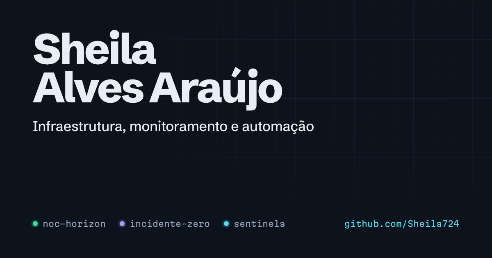

# Portfólio — Sheila Alves Araújo

Portfólio pessoal em português e inglês, instalável no celular como app (PWA).
Infraestrutura, monitoramento e automação: projetos, stack, trajetória e contato.



## Stack

- **Next.js 16** (App Router) com **export 100% estático**: o resultado é HTML/CSS puro em `out/`
- **TypeScript** em modo estrito, conteúdo tipado
- **Tailwind CSS 4** com tokens próprios em `src/app/globals.css`
- **Zero JavaScript obrigatório**: detalhes dos projetos e menu usam o [Popover API](https://developer.mozilla.org/docs/Web/API/Popover_API) nativo; um script inline de ~1 KB só adiciona conveniências (link direto para projeto, copiar e-mail, service worker)
- **PWA**: manifest, ícones (inclusive maskable) e service worker com cache offline
- **SEO**: metadados por idioma, `hreflang`, Open Graph, sitemap, robots e JSON-LD (`Person`)
- **Acessibilidade**: HTML semântico, foco visível, link "pular para o conteúdo", `prefers-reduced-motion` respeitado
- **CI** no GitHub Actions: typecheck, lint, build, verificação das páginas, gitleaks e teste da imagem Docker; Dependabot semanal

## Estrutura

```
src/
  app/[lang]/        página e layout por idioma (pt, en)
  app/manifest.ts    manifest do PWA
  components/        Header, Hero (painel de status), Projects, Stack, Journey, Contact
  content/           TODO o conteúdo do site — edite aqui
    site.ts          nome, e-mail, links, URL final
    projects.ts      projetos (PT/EN), status, stack, links
    academic.ts      projetos acadêmicos da FATEC
    stack.ts         tecnologias por área
    journey.ts       trajetória
    dictionary.ts    textos da interface
  lib/               i18n, globo SVG, script de melhoria progressiva
public/              ícones, favicon, og.png, sw.js, redirecionamento da raiz
deploy/nginx.conf    Nginx com cabeçalhos de segurança e cache
```

## Rodando

```bash
npm ci
npm run dev        # http://localhost:3000/pt/
npm run check      # typecheck + lint + build
npm run start      # serve a pasta out/ já gerada
```

A raiz `/` é um `index.html` estático que redireciona para `/pt/` ou `/en/` conforme o idioma do navegador. No `next dev`, abra direto `/pt/`.

## Adicionando um projeto

Inclua um objeto em `src/content/projects.ts`. Campos principais:

| Campo | Para quê |
| --- | --- |
| `slug` | id único; vira o link direto `/#slug` |
| `status` | `live`, `building` ou `demo` (cor do indicador) |
| `visibility` | `public` mostra o botão do GitHub; `private` mostra o cadeado |
| `featured` | `globe`, `terminal` ou `fleet` para os destaques com ilustração |
| `tagline`, `problem`, `solution`, `highlights` | textos em `pt` e `en` |

O painel do topo, a contagem "X de Y no ar" e o número de projetos por tecnologia na seção Stack são calculados automaticamente.

## Deploy

### Docker (VPS)

```bash
docker compose up -d --build     # sobe em 127.0.0.1:8088
```

Aponte o proxy reverso (Traefik, Nginx ou Cloudflare Tunnel) para a porta 8088.

### Cloudflare (recomendado)

Conecte o repositório em Workers & Pages. Comando de build `npm run build`, comando de implantação `npx wrangler deploy`.
A configuração fica em `wrangler.jsonc` (publica a pasta `out`), a versão do Node em `.node-version` e os cabeçalhos de segurança e cache em `public/_headers`. Cada push na `main` publica sozinho.

### Vercel

Comando de build `npm run build`, pasta de saída `out`.

Antes de publicar, ajuste `site.url` em `src/content/site.ts` para o domínio final (usado em SEO, sitemap e Open Graph).

## Atualizações

Ao mudar o site, troque `VERSION` em `public/sw.js` para que o service worker descarte o cache antigo.

## Créditos

Fontes: [Schibsted Grotesk](https://github.com/schibsted/schibsted-grotesk) e [Martian Mono](https://github.com/evilmartians/mono), ambas sob SIL Open Font License.
